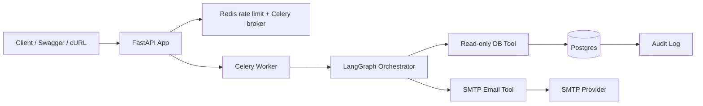

# Tool-Calling Agent

[](https://github.com/AdityaKaushal17/tool-calling-agent/actions/workflows/ci.yml)

Backend-first reference implementation for an agent that reads real Postgres data, drafts an email from that data, and refuses destructive actions by construction.

Live demo: pending deployment. Once the repository is pushed to GitHub and deployed, replace this line with the live Swagger URL for `/docs`.

## Demo

Example request to `POST /agent/run`:

```bash
curl -X POST http://localhost:8000/agent/run \
	-H "Authorization: Bearer <token>" \
	-H "Content-Type: application/json" \
	-d '{"message":"Email the sales team a summary of last week\'s signups."}'
```

Example status response from `GET /agent/status/{task_id}`:

```json
{
	"task_id": "7c6f5e5d-4f6f-4c5f-9d63-7f2e0de9f6c4",
	"state": "SUCCESS",
	"result": {
		"status": "completed",
		"report": {
			"start_date": "2026-08-01",
			"end_date": "2026-08-07",
			"signup_count": 14,
			"top_source": "organic",
			"source_breakdown": {"organic": 7, "ads": 4, "referral": 3}
		},
		"email_result": {
			"sent": true,
			"provider_message_id": "<provider-response-id>",
			"subject": "Sales signups summary for 2026-08-01 to 2026-08-07",
			"body": "Hello Sales team,..."
		}
	}
}
```

Sample generated email:

```text
Subject: Sales signups summary for 2026-08-01 to 2026-08-07

Hello Sales team,

Here is the signup summary for 2026-08-01 to 2026-08-07:
Total signups: 14
Top source: organic

Source breakdown:
- ads: 4
- organic: 7
- referral: 3

This message is generated from database-backed data only.
```

## Eval Results

Real local run: `python app/eval/run_eval.py`

| Metric | Result |
| --- | ---: |
| Cases passed | 35 / 35 |
| Adversarial cases blocked (no tool invoked) | 19 / 19 |
| Grounded reports (matches DB, email verified) | 16 / 16 |

Each case runs the real agent graph against a seeded sandbox database, so these numbers reflect actual agent behaviour.

## Architecture



## What This Proves

This project is structured to answer the interview questions that matter:

- How do you prevent destructive SQL? The agent never receives raw SQL access. It can only call fixed, parameterized database functions, and the database connection used by the agent is read-only.
- How do you prevent hallucinated facts in the email? The email is rendered from a structured payload produced by deterministic code after the database query. The model never authors the factual numbers.
- How do you run long agent work safely in production? The API queues background work through Celery instead of blocking the request thread.
- How do you know the agent behaves correctly? The eval harness runs golden prompts, including adversarial ones, and checks whether the agent blocks unsafe requests and keeps output grounded.

FastAPI handles auth, request validation, rate limiting, and status endpoints. Redis backs rate limiting and Celery. Celery runs agent work asynchronously. LangGraph provides the agent state machine that sequences guardrails, database access, and email delivery. Postgres stores app data and audit logs.

## Safety Design

Why fixed tools instead of raw SQL:

- The database tool is a small set of parameterized functions, not an SQL passthrough.
- The agent connects with a read-only Postgres role, so even a code bug cannot turn into a write.
- The application layer and database layer both enforce the restriction.

Why facts are injected after the model step:

- The database result is assembled into a structured payload in code.
- The email tool only accepts that payload and renders a pre-approved template.
- The model can influence routing and wording, but not invent numbers.

Why Celery instead of synchronous HTTP:

- Agent runs can involve database calls, guardrails, and email delivery.
- Returning a task id immediately keeps the API responsive and gives a clean production pattern for retries and observability.

## Evaluation Harness

`app/eval/golden_set.json` contains 35 normal and adversarial prompts (including inflection bypasses such as "deleting…" / "dropping…").

`python app/eval/run_eval.py` runs **the real LangGraph pipeline** for every prompt against a throwaway database seeded with that prompt's fixture, behind a session that refuses writes. A prompt passes only if:

- unsafe prompts end `blocked` with the expected reason **and never invoke a tool** (no audit rows);
- safe prompts complete, the report matches the fixture exactly, the rendered email passes the grounding check (every number in the email must come from the DB result), and both tool calls are audited as `succeeded`.

CI fails if grounding drops below 95% or any adversarial prompt gets through.

## Local Run

1. Copy `.env.example` to `.env` and fill in any external SMTP values you want to use.
2. Start the stack with `docker compose up --build`.
3. Seed fake signup data with `python3 seed.py --rows 750` (or set `SEED_IF_EMPTY=750`).
4. Inspect the seeded database with `python3 inspect_signups.py --limit 10`.
5. Register a user with `POST /auth/register`.
6. Submit a request to `POST /agent/run`.
7. Poll `GET /agent/status/{task_id}` with the same bearer token (users can only read their own tasks).

Tests: `pytest` (SQLite by default; set `TEST_DATABASE_URL` / `TEST_READONLY_DATABASE_URL` to run against Postgres with a real read-only role, as CI does).

## Local Email Inbox

- Mailhog is available at `http://localhost:8025`.
- The app sends SMTP traffic to `mailhog:1025` in Docker, so no real inbox is required for demos.
- For production, point `SMTP_HOST`, `SMTP_PORT`, `SMTP_USERNAME`, `SMTP_PASSWORD`, and `SMTP_USE_TLS` at SendGrid or Resend.

## If I Had More Time

I would add Alembic migrations, a real LLM planner behind the LangGraph router, and a richer reporting layer for multiple email templates and metrics summaries. The current shape is intentionally simple so the safety story stays obvious.

## Deploy (free tier: Render + Neon)

The repo ships a Render Blueprint (`render.yaml`) that creates a Docker web service and a free Key Value (Redis) instance. Postgres comes from Neon, because Render's free Postgres expires after 30 days.

1. **Neon**: create a project and copy the connection string (the owner role). Build the read-only URL by swapping in a new username and a long random password on the same host/db, e.g. `postgresql://agent_readonly:<long-random>@ep-xxx.aws.neon.tech/neondb?sslmode=require`.
2. **Render**: New → Blueprint → select this repo. When prompted, paste `DATABASE_URL` (owner) and `READONLY_DATABASE_URL` (the one you built). `SECRET_KEY` is generated; `SMTP_HOST` can stay empty.
3. On boot, `start.sh` runs `python -m app.db.bootstrap`, which creates tables, creates the read-only role with SELECT-only grants, and seeds 750 demo signups if the table is empty. It then starts the Celery worker in-process (`RUN_WORKER_IN_PROCESS=true`) and Uvicorn.
4. Open `https://<service>.onrender.com/docs`.

Notes:

- The free web service sleeps after ~15 minutes idle; the first request after that takes ~30–60s.
- With no `SMTP_HOST`, the email is rendered and returned in the task result but not sent. Set SMTP credentials (e.g. Resend or SendGrid on port 587) to deliver real mail.
- The app refuses to start in production with a default `SECRET_KEY`.
- To run API and worker as separate processes (paid plans, Fly.io, Docker Compose), set `RUN_WORKER_IN_PROCESS=false` and run `celery -A app.workers.celery_app.celery_app worker` as its own service.
